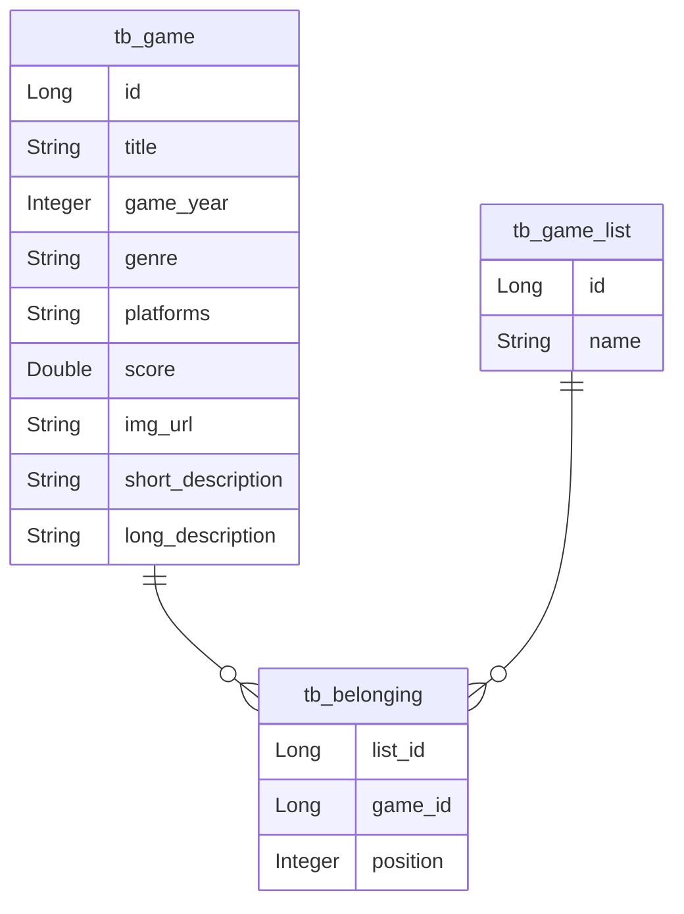

# DSList

API REST para catálogo de jogos organizados em listas, desenvolvida com **Java** e **Spring Boot**. Permite consultar jogos, ver as listas disponíveis e reordenar os jogos dentro de uma lista.

Projeto desenvolvido durante o Intensivão Java Spring da [DevSuperior](https://devsuperior.com.br).

## Tecnologias

- Java 24
- Spring Boot 3.5
- Spring Web
- Spring Data JPA / Hibernate
- H2 Database (perfil de testes)
- PostgreSQL (perfis de desenvolvimento e produção)
- Maven

## Modelo de domínio



Um jogo pode pertencer a várias listas, e cada lista guarda a posição do jogo nela. Essa relação é feita pela entidade `Belonging`, que usa chave primária composta (`BelongingPK`).

## Estrutura do projeto

```
src/main/java/com/dev/dslist
├── config         # Configuração de CORS
├── controllers    # Endpoints REST
├── dto            # Objetos de transferência de dados
├── entities       # Entidades JPA
├── projection     # Projeções para consultas nativas
├── repositories   # Repositórios Spring Data JPA
└── services       # Regras de negócio
```

## Endpoints

| Método | Rota | Descrição |
|--------|------|-----------|
| GET | `/games` | Lista todos os jogos (versão resumida) |
| GET | `/games/{id}` | Retorna os detalhes de um jogo |
| GET | `/lists` | Lista todas as listas de jogos |
| GET | `/lists/{listId}/games` | Retorna os jogos de uma lista, ordenados pela posição |
| POST | `/lists/{listId}/replacement` | Move um jogo de posição dentro da lista |

Exemplo de corpo para `POST /lists/{listId}/replacement`:

```json
{
  "sourceIndex": 3,
  "destinationIndex": 1
}
```

## Perfis de execução

O perfil é definido pela variável `APP_PROFILE` (padrão: `test`).

| Perfil | Banco | Observações |
|--------|-------|-------------|
| `test` | H2 em memória | Popula os dados com `import.sql`. Console em `/h2-console` |
| `dev` | PostgreSQL local (`localhost:5433/dslist`) | Ajuste usuário e senha em `application-dev.properties` |
| `prod` | PostgreSQL | Usa as variáveis `DB_URL`, `DB_USERNAME` e `DB_PASSWORD` |

As origens liberadas no CORS vêm da variável `CORS_ORIGINS` (padrão: `http://localhost:5173,http://localhost:3000`).

## Como executar

Pré-requisitos: Java 24 instalado.

```bash
git clone https://github.com/MatheusAvelinods/dslist.git
```

```bash
cd dslist
```

```bash
./mvnw spring-boot:run
```

A API fica disponível em `http://localhost:8080`. Com o perfil padrão (`test`), o banco H2 já sobe com duas listas e dez jogos de exemplo.

## Autor

Matheus Avelino — [GitHub](https://github.com/MatheusAvelinods)
